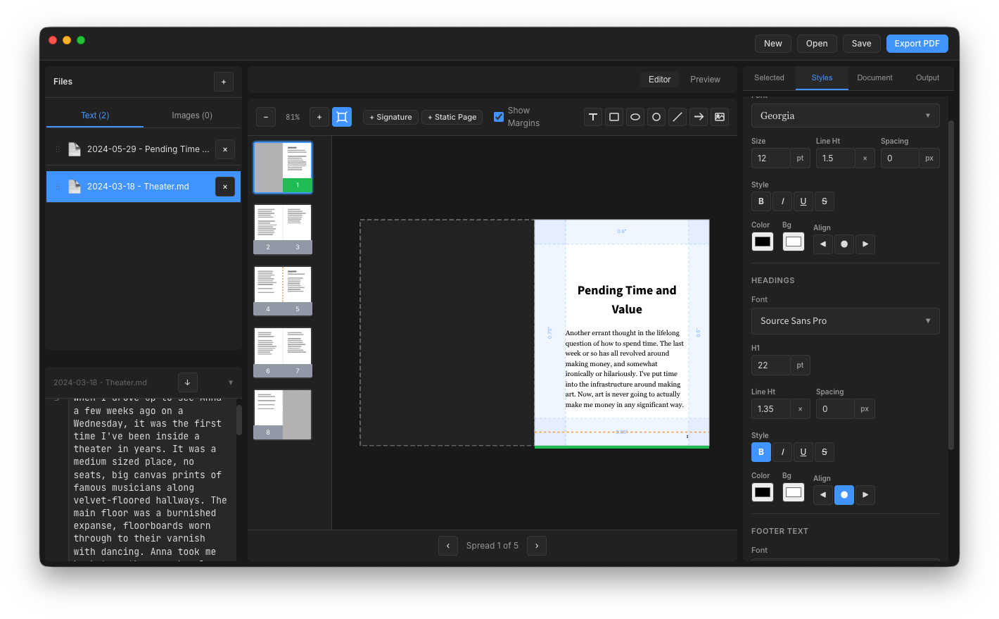

# PrintFold

Turns Markdown documents into printable, signature-based booklets, as a PDF
you can fold and bind. Projects are saved as `.printfold` files.

This is a Rust + Tauri 2 port of [laffan/printfold](https://github.com/laffan/printfold)
and reads and writes the same project files. It is also built for iPadOS; see
[docs/ipados.md](docs/ipados.md).



## Installation

Download the installer for your system from the
[Releases](../../releases) page: `.dmg` (macOS), `.msi` or `.exe` (Windows),
`.AppImage`, `.deb` or `.rpm` (Linux).

The builds are not code-signed. On macOS, if the app is blocked on first
launch, move it to Applications and run:

```sh
xattr -cr "/Applications/PrintFold.app"
```

On Windows, choose "More info" then "Run anyway" when SmartScreen warns.

### Build from source

Requires [Node.js](https://nodejs.org/), [Rust](https://rustup.rs/) and the
[Tauri prerequisites](https://v2.tauri.app/start/prerequisites/) for your OS.

```sh
npm install
npm run tauri build    # installers end up in src-tauri/target/release/bundle/
npm run tauri dev      # run in development
```

Tests: `cargo test --workspace` and `npm run typecheck`.

## More detail

Technical documentation starts at [docs/README.md](docs/README.md).
